<h1 align="center">STEEL MIND</h1>

<p align="center">
  <b>제철소 돌발상황 대처 진단 시뮬레이션</b><br>
  신입 운영자가 열간압연 라인의 사건을 처리하면, AI가 약한 역량을 찾아 다음 돌발상황을 고르고 진단 보고서와 맞춤 재훈련으로 이어 줍니다.
</p>

<p align="center">
  
  
  
  
  
  
</p>

<p align="center">
  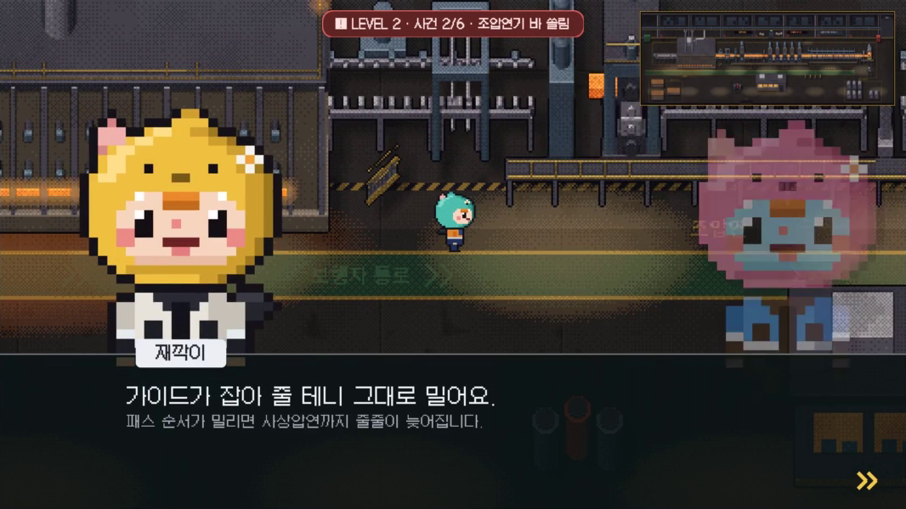<br>
  <sub>LEVEL 2 · 조압연기 바 쏠림 — 동료들이 서로 다른 조치를 말하고, 판단은 플레이어가 합니다.</sub>
</p>

---

## 한눈에

| | |
| --- | --- |
| **무엇** | 열간압연 라인을 걸어 다니며 사건을 처리하는 2D 픽셀 시뮬레이션. 선택마다 5가지 대처 역량을 점수로 쌓고, 끝나면 진단 보고서와 재훈련을 제공 |
| **누구를 위해** | 제철소 신입 운영자 교육 · 교육 담당자의 맞춤 교육·사수 매칭 |
| **AI가 하는 일** | 규칙이 추린 후보 3개 중 약점을 노릴 **다음 돌발상황을 고르고 이유를 밝힘**, 판이 끝나면 **진단 문장과 코칭 2개 작성** |
| **AI가 하지 않는 일** | 점수 계산·승패 판정. 점수는 규칙이 계산하고, AI 응답이 없어도 기본 문장으로 끝까지 진행 |
| **팀** | LLM 1기 철든신입 · 박소영(팀장) 양수빈 신원민 김다영 |
| **행사** | POSCO K-뉴딜 아카데미 내부 해커톤 (2026-11-09 ~ 11-10) |

해커톤 대주제 「AI로 더 안전하고, 멈추지 않고, 더 정확하게 생산하는 제철소」에 대한 팀의 답은 **"사람이 그 판단을 할 수 있는지 미리 보고, 약한 부분만 다시 훈련한다"** 입니다.

> 가상의 교육용 시뮬레이션입니다. 설비 상황과 수치는 게임 밸런스용이며 실제 제철소 기준이 아닙니다. 진단 결과는 교육·코칭 추천용이고 인사 배치나 업무 적합성 판단에 쓰지 않습니다.

## 실행 방법 (제출한 exe)

Windows 64비트에서 실행합니다. 설치는 필요 없습니다.

1. 제출한 압축 파일을 풉니다. `SteelMind.exe`와 `SteelMind_Data/` 폴더가 같은 곳에 있어야 합니다.
   ```
   SteelMind/
   ├─ SteelMind.exe
   ├─ SteelMind_Data/
   ├─ UnityPlayer.dll
   ├─ …
   └─ .env          ← AI를 쓰려면 직접 만듭니다 (선택)
   ```
2. **AI 기능을 켜려면** `SteelMind.exe`와 같은 폴더에 `.env` 파일을 만들고 아래처럼 적습니다.
   ```
   GEMINI_API_KEY=발급받은_키
   GEMINI_MODEL=gemini-3.5-flash-lite
   ```
   키가 없으면 규칙 기반으로 다음 사건을 고르고 기본 진단 문장을 보여 주며, 게임은 그대로 끝까지 진행됩니다.
3. `SteelMind.exe`를 실행합니다. Windows SmartScreen 경고가 뜨면 **추가 정보 → 실행**을 누릅니다.
4. 타이틀에서 **Space**로 시작합니다.

| 조작 | 키 |
| --- | --- |
| 이동 | WASD / 방향키 |
| 대사 넘기기 · 시작 | Space / Enter |
| 선택지 고르기 | 숫자키 1 · 2 · 3 |
| 전체 공정 보기 | Tab |
| 월드맵 | M |
| 보고서 장 넘기기 | ← / → |

판이 끝나면 진단 기록이 `%USERPROFILE%\AppData\LocalLow\DefaultCompany\SteelMind\`에 회차별 JSON으로 저장됩니다.

### 소스에서 실행 (Unity 에디터)

1. Unity Hub에 **Unity 6000.3.27f1**을 설치하고, `unity/SteelMind` 폴더를 프로젝트로 추가합니다.
2. AI를 쓰려면 레포 루트에서 `cp .env.example .env` 후 `GEMINI_API_KEY`를 채웁니다. `.env`는 Git에 올라가지 않습니다.
3. `Assets/SteelMind/Scenes/Title.unity`를 열고 ▶ Play 합니다.

## 게임 화면

<table>
  <tr>
    <td width="50%" align="center" valign="top">
      <b>1. 타이틀 · 야간 교대 시작</b><br>
      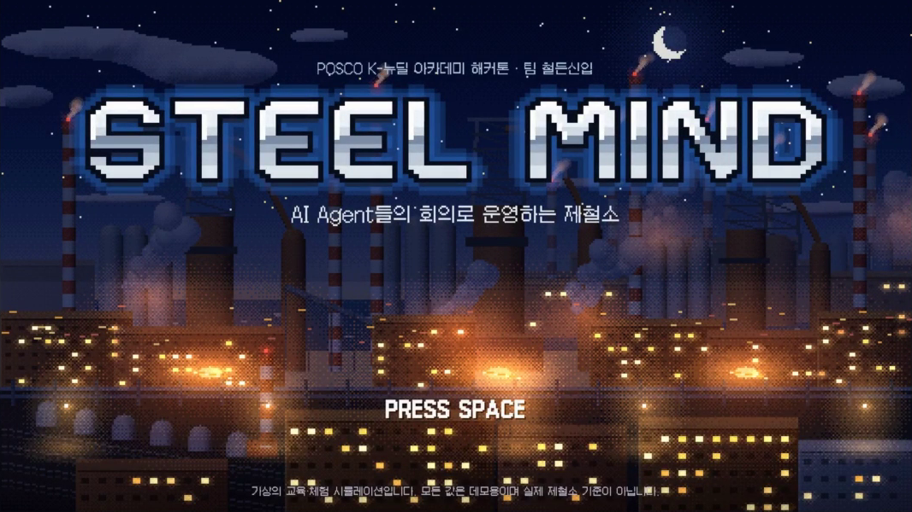<br>
      <sub>"오늘 당신은 처음으로 이 라인의 운영 책임자를 맡았습니다."</sub>
    </td>
    <td width="50%" align="center" valign="top">
      <b>2. 열간압연 라인 둘러보기</b><br>
      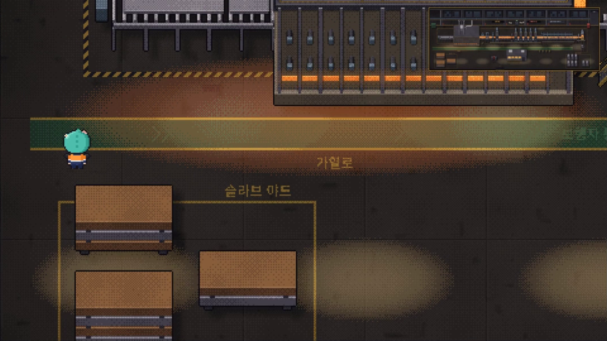<br>
      <sub>가열로 → 스케일 제거기 → 조압연 → 사상압연 → 런아웃 테이블 → 권취기</sub>
    </td>
  </tr>
  <tr>
    <td width="50%" align="center" valign="top">
      <b>3. 사건 발생 · 경보와 현장 이동</b><br>
      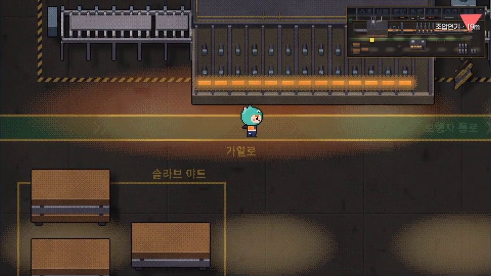<br>
      <sub>설비가 깜빡이고 경보음이 울리면 화살표를 따라 현장으로 갑니다.</sub>
    </td>
    <td width="50%" align="center" valign="top">
      <b>4. 결정 · 선택지 3개</b><br>
      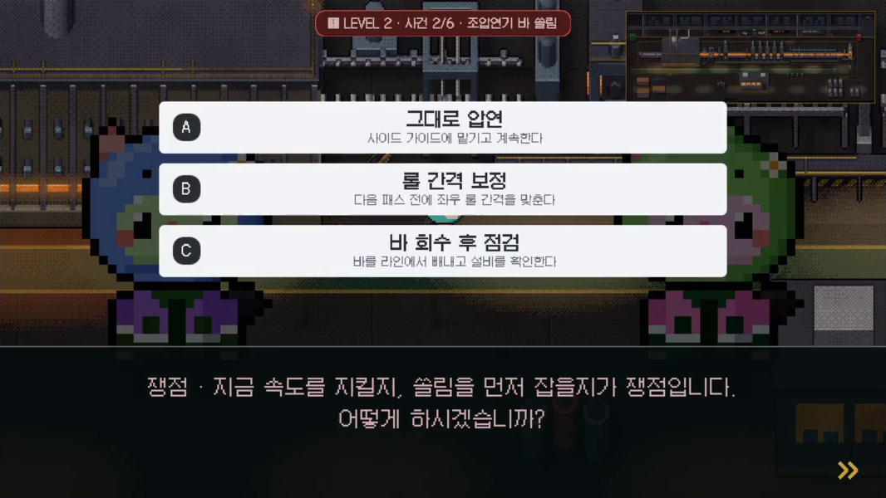<br>
      <sub>공짜 선택지는 없습니다. 생산·품질·안전·비용 손실과 역량 점수가 규칙대로 계산됩니다.</sub>
    </td>
  </tr>
  <tr>
    <td width="50%" align="center" valign="top">
      <b>5. AI가 고른 돌발상황</b><br>
      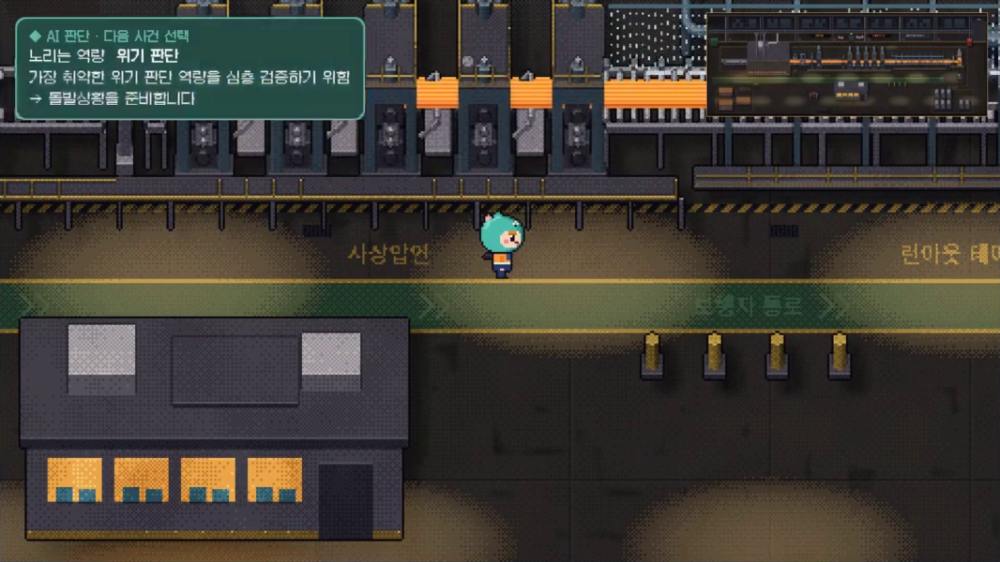<br>
      <sub>"가장 취약한 위기 판단 역량을 심층 검증하기 위함" — Gemini가 쓴 선택 이유</sub>
    </td>
    <td width="50%" align="center" valign="top">
      <b>6. 진단 보고서</b><br>
      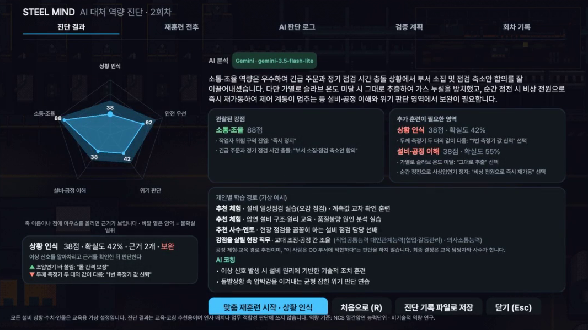<br>
      <sub>역량 레이더 · AI 진단과 코칭 · 추천 교육·사수·NCS 능력단위</sub>
    </td>
  </tr>
  <tr>
    <td width="50%" align="center" valign="top">
      <b>7. 맞춤 재훈련 전후 비교</b><br>
      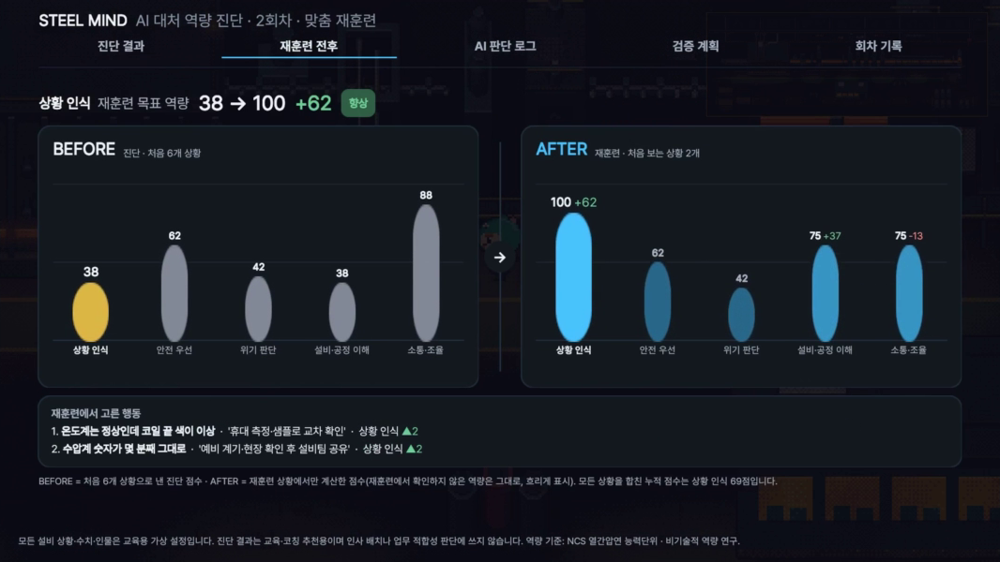<br>
      <sub>약한 역량만 처음 보는 상황으로 다시 훈련하고 BEFORE/AFTER를 비교합니다.</sub>
    </td>
    <td width="50%" align="center" valign="top">
      <b>8. 섬 월드맵 · 4개 공정</b><br>
      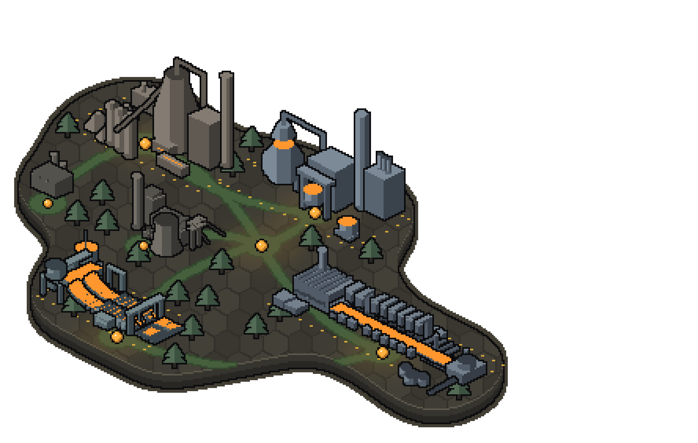<br>
      <sub>제선 · 제강 · 연주 · 압연 맵 사이를 이동할 수 있습니다.</sub>
    </td>
  </tr>
</table>

## 한 판의 흐름

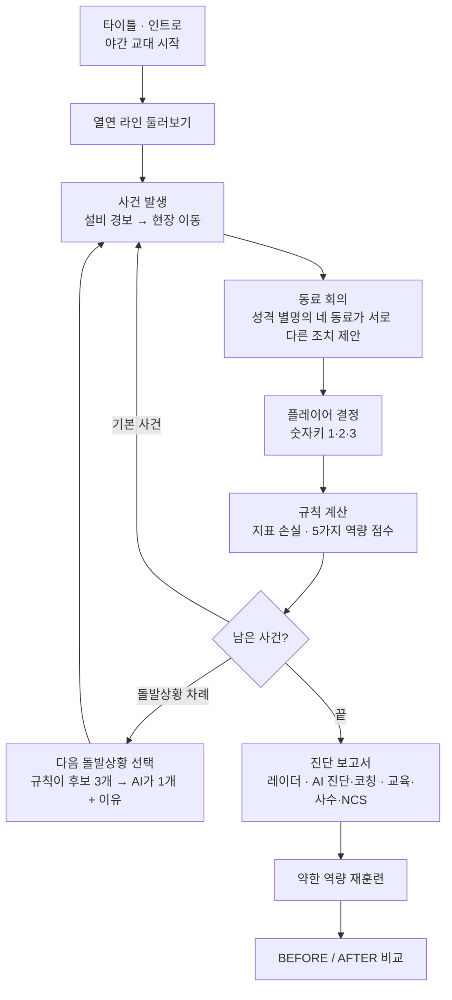

- **기본 사건 6개** — 가열로 온도 미달 · 스케일 제거기 수압 저하 · 조압연기 바 쏠림 · 사상압연기 온도 상승 · 작업자 위험 구역 진입 · 권취기 코일 옆면 밀림
- **돌발상황 6개** — 순간 정전 · 냉각수 배관 파열 · 두께 측정기 값 불일치 · 긴급 주문과 정기 점검 충돌 · 크레인 과부하 · 신입의 "이상한 소리" 보고
- **5가지 대처 역량** — 상황 인식 · 안전 우선 · 위기 판단 · 설비·공정 이해 · 소통·조율

## AI와 규칙의 경계

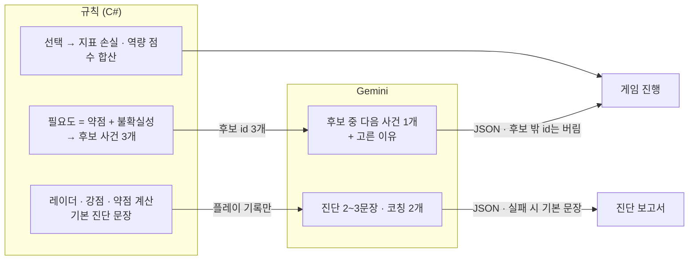

| 규칙이 하는 일 | AI가 하는 일 |
| --- | --- |
| 지표 손실·역량 점수 계산, 후보 3개 추리기, 레이더·강약점 계산, 기본 문장 | 후보 중 다음 사건 선택과 이유, 진단 문장과 코칭 |

- AI는 점수를 바꾸지 못합니다. 같은 선택이면 점수는 언제나 같습니다.
- AI 응답은 JSON으로만 받고, 후보에 없는 id는 버립니다. 6초 안에 답이 없으면 규칙이 고릅니다.
- 진단 프롬프트는 플레이 기록만 근거로 주고 "숫자를 지어내지 마라"는 조건을 둡니다.
- API 키는 코드·빌드에 넣지 않고 `.env` 또는 환경 변수에서만 읽으며, URL이 아니라 `x-goog-api-key` 헤더로 보냅니다.

## 기술 스택

| 영역 | 사용 기술 |
| --- | --- |
| 게임 엔진 | Unity 6 (6000.3.27f1), Universal 2D(URP), Input System |
| 게임 로직 | C# — 시나리오 진행, 역량 모델·적응형 출제, 보고서·레이더 차트 |
| AI | Google Gemini API (`gemini-3.5-flash-lite` 기본, 쓸 수 없으면 대체 모델로 재시도) |
| 데이터 | JSON 한 파일에 사건·선택지·손실값·역량 점수·연결 규칙·추천 교육 (`scenarios/hot_rolling.json`) |
| 아트·사운드 | Python(Pillow, NumPy)으로 픽셀 맵·캐릭터·배경음 생성 (`tools/pixel-art/`), Galmuri·Pretendard 글꼴 |
| 기획·검증 | HTML 시안, 729개 선택 경로 결과표 (`scenarios/hot-rolling-results.md`) |

## 시스템 구성

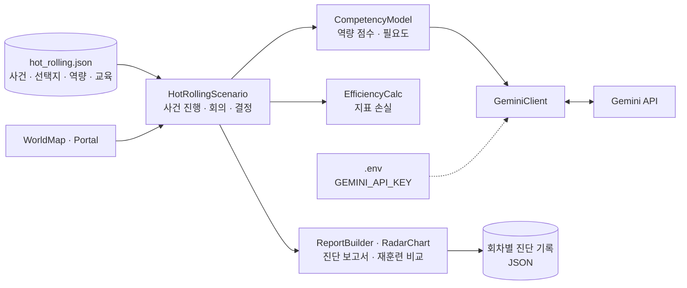

## 폴더

| 폴더 | 내용 |
| --- | --- |
| `unity/SteelMind/` | Unity 프로젝트. 장면 5개(Title · Rolling · Ironmaking · Steelmaking · Casting) |
| `scenarios/` | 열간압연 시나리오 JSON과 729개 경로 결과표 |
| `tools/pixel-art/` | 맵·캐릭터·설비·배경음을 만드는 Python 스크립트 |
| `docs/` | 기획서(v1~v3), 에이전트 설계서, 회의록, 결과보고서 |
| `schemas/` | 에이전트 응답 JSON 예시 |

## 팀 작업 규칙

- `main`에 직접 올리지 않고, 폴더 이름으로 시작하는 브랜치(`frontend/…`, `scenarios/…`, `llm/…`, `docs/…`)에서 작업해 Pull Request로 합칩니다.
- Pull Request는 다른 팀원 1명 이상이 승인해야 합칩니다.
- `.env`와 Unity `Library/`는 올리지 않고, `.meta` 파일은 항상 같이 커밋합니다.
- 커밋 메시지는 `type(scope): 영어 요약` + 한글 본문 형식을 씁니다.
