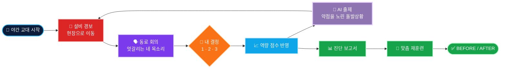

<p align="center">
  
</p>

<p align="center">
  <b>🔥 열연 라인을 직접 걸으며 사건을 처리하면, AI가 내 약점을 찾아 다음 돌발상황을 던집니다.</b><br>
  진단 보고서 → 맞춤 재훈련 → BEFORE / AFTER 비교까지 한 판에.
</p>

<p align="center">
  
  
  
  
  
</p>

<p align="center">
  
  
  
  
  
</p>

<p align="center">
  <br>
  <sub>LEVEL 2 · 조압연기 바 쏠림 — 네 동료가 서로 다른 조치를 말하고, 결정은 내가 합니다.</sub>
</p>

<p align="center">
  <b>팀 철든신입</b> · 박소영 · 양수빈 · 신원민 · 김다영<br>
  <sub>POSCO K-뉴딜 아카데미 내부 해커톤 · 2026.11.09 – 11.10</sub>
</p>

---

## 🏭 프로젝트 소개

> **해커톤 대주제** — AI로 더 **안전**하고, **멈추지 않고**, 더 **정확하게** 생산하는 제철소
>
> **우리의 답** — 그 판단을 사람이 할 수 있는지 미리 보고, 약한 부분만 골라 다시 훈련한다.

| | |
| :---: | --- |
| 🎮 | 열간압연 라인을 걸어 다니며 경보가 울린 설비로 달려가 사건을 처리하는 **2D 픽셀 시뮬레이션** |
| 🗣️ | 성격이 다른 네 동료가 서로 다른 조치를 주장하는 **비주얼 노벨식 회의** |
| 🧠 | 선택마다 **5가지 대처 역량** 점수가 쌓이고, AI가 가장 약한 역량을 노린 **돌발상황을 골라 출제** |
| 📊 | 역량 레이더 · AI 진단과 코칭 · 추천 교육 · 사수 매칭 · NCS 능력단위가 담긴 **진단 보고서** |
| 🔁 | 약한 역량만 처음 보는 상황으로 **재훈련**하고 BEFORE / AFTER를 막대그래프로 비교 |

**5가지 대처 역량** &nbsp;


## 🚀 실행 방법

### 제출한 exe로 실행 (Windows)

1. 압축을 풀고, `SteelMind.exe`와 `SteelMind_Data/` 폴더가 같은 곳에 있는지 확인합니다.
2. **AI 기능을 켜려면** `SteelMind.exe` 옆에 `.env` 파일을 만들고 아래처럼 적습니다.
   ```env
   GEMINI_API_KEY=발급받은_키
   GEMINI_MODEL=gemini-3.5-flash-lite
   ```
3. `SteelMind.exe`를 더블클릭합니다. SmartScreen 경고가 뜨면 **추가 정보 → 실행**.
4. 타이틀에서 **Space**로 출근!

```
SteelMind/
├─ SteelMind.exe
├─ SteelMind_Data/
├─ UnityPlayer.dll
└─ .env        ← AI 연결용 (직접 만들기)
```

| 조작 | 키 | | 조작 | 키 |
| --- | :---: | --- | --- | :---: |
| 이동 | `WASD` `←↑↓→` | | 선택지 고르기 | `1` `2` `3` |
| 대사 넘기기 · 시작 | `Space` `Enter` | | 전체 공정 보기 | `Tab` |
| 보고서 장 넘기기 | `←` `→` | | 월드맵 | `M` |

판이 끝나면 회차별 진단 기록이 `%USERPROFILE%\AppData\LocalLow\DefaultCompany\SteelMind\`에 JSON으로 저장됩니다.

### Unity 에디터에서 실행

1. Unity Hub에 **Unity 6000.3.27f1**을 설치하고 `unity/SteelMind` 폴더를 프로젝트로 추가합니다.
2. 레포 루트에서 `cp .env.example .env` 후 `GEMINI_API_KEY`를 채웁니다.
3. `Assets/SteelMind/Scenes/Title.unity`를 열고 ▶ Play.

## 🎬 게임 화면

<table>
  <tr>
    <td width="50%" align="center" valign="top">
      <b>① 타이틀 · 야간 교대 시작</b><br>
      <br>
      <sub>"오늘 당신은 처음으로 이 라인의 운영 책임자를 맡았습니다."</sub>
    </td>
    <td width="50%" align="center" valign="top">
      <b>② 열간압연 라인 둘러보기</b><br>
      <br>
      <sub>가열로 → 스케일 제거기 → 조압연 → 사상압연 → 런아웃 테이블 → 권취기</sub>
    </td>
  </tr>
  <tr>
    <td width="50%" align="center" valign="top">
      <b>③ 🚨 사건 발생 · 현장으로</b><br>
      <br>
      <sub>설비가 깜빡이고 경보음이 울리면 화살표를 따라 달려갑니다.</sub>
    </td>
    <td width="50%" align="center" valign="top">
      <b>④ 결정의 순간 · 선택지 3개</b><br>
      <br>
      <sub>속도를 지킬까, 쏠림부터 잡을까? 공짜 선택지는 없습니다.</sub>
    </td>
  </tr>
  <tr>
    <td width="50%" align="center" valign="top">
      <b>⑤ 🤖 AI가 고른 돌발상황</b><br>
      <br>
      <sub>"가장 취약한 위기 판단 역량을 심층 검증하기 위함" — Gemini가 쓴 출제 이유</sub>
    </td>
    <td width="50%" align="center" valign="top">
      <b>⑥ 📊 진단 보고서</b><br>
      <br>
      <sub>역량 레이더 · AI 진단과 코칭 · 추천 교육 · 사수 · NCS 능력단위</sub>
    </td>
  </tr>
  <tr>
    <td width="50%" align="center" valign="top">
      <b>⑦ 🔁 맞춤 재훈련 BEFORE / AFTER</b><br>
      <br>
      <sub>약한 역량만 다시 훈련 — 상황 인식 38 → 100</sub>
    </td>
    <td width="50%" align="center" valign="top">
      <b>⑧ 🗺️ 섬 월드맵 · 4개 공정</b><br>
      <br>
      <sub>제선 · 제강 · 연주 · 압연 맵을 오가며 둘러볼 수 있습니다.</sub>
    </td>
  </tr>
</table>

## 🔄 한 판의 흐름



**기본 사건 6개** — 가열로 온도 미달 · 스케일 제거기 수압 저하 · 조압연기 바 쏠림 · 사상압연기 온도 상승 · 작업자 위험 구역 진입 · 권취기 코일 옆면 밀림<br>
**돌발상황 6개** — 순간 정전 · 냉각수 배관 파열 · 두께 측정기 값 불일치 · 긴급 주문과 정기 점검 충돌 · 크레인 과부하 · 신입의 "이상한 소리" 보고

## 🤖 AI가 하는 일

<table>
  <tr>
    <td width="50%" valign="top">
      <br><br>
      약점과 불확실성으로 추린 후보 3개 중, <b>지금 이 사람에게 가장 필요한 돌발상황</b>을 Gemini가 고르고 <b>왜 골랐는지</b> 화면에 밝힙니다. 그래서 사람마다 다른 순서로 문제가 나옵니다.
    </td>
    <td width="50%" valign="top">
      <br><br>
      판이 끝나면 플레이 기록을 근거로 <b>진단 2~3문장과 훈련 코칭 2개</b>를 씁니다. 점수 계산은 규칙이 맡고, AI는 <b>해석과 다음 행동 제안</b>에 집중합니다.
    </td>
  </tr>
</table>

## 🛠️ 기술 스택

| 영역 | 사용 기술 |
| --- | --- |
| **게임** |     |
| **AI** |   |
| **데이터** |  사건 · 선택지 · 역량 점수 · 추천 교육을 한 파일로 |
| **아트 · 사운드** |    픽셀 맵 · 캐릭터 · 배경음 생성, Galmuri · Pretendard 글꼴 |
| **협업** |   |

## 📁 폴더

| 폴더 | 내용 |
| --- | --- |
| [`unity/SteelMind/`](unity/SteelMind) | Unity 프로젝트 · 장면 5개 (Title · Rolling · Ironmaking · Steelmaking · Casting) |
| [`scenarios/`](scenarios) | 열간압연 시나리오 JSON과 729개 선택 경로 결과표 |
| [`tools/pixel-art/`](tools/pixel-art) | 맵 · 캐릭터 · 설비 · 배경음을 만드는 Python 스크립트 |
| [`docs/`](docs) | 기획서 v1 – v3, 에이전트 설계서, 회의록, 결과보고서 |

## 🤝 팀 작업 규칙

- `main`에 직접 올리지 않고 `frontend/…` `scenarios/…` `llm/…` `docs/…` 브랜치에서 작업해 Pull Request로 합칩니다.
- Pull Request는 다른 팀원 1명 이상이 승인해야 합칩니다.
- `.env`와 Unity `Library/`는 올리지 않고, `.meta` 파일은 항상 같이 커밋합니다.
- 커밋 메시지는 `type(scope): 영어 요약` + 한글 본문.

<p align="center">
  
</p>
