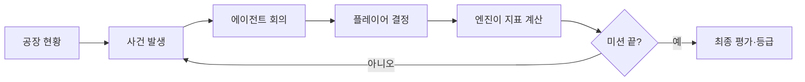

# STEEL MIND

**AI 에이전트들의 엇갈린 제안을 듣고, 제철소 운영 책임자로서 최종 결정을 내리는 시뮬레이션 게임.**

- 시안: [`steel-mind-prototype.html`](steel-mind-prototype.html). 브라우저로 열면 압연 미션을 처음부터 결과까지 해 볼 수 있습니다.
- 바탕: 이전 프로젝트 「철든 신입」(ST-ROOKIE)의 공정 구분(제선·제강·연주·압연)과 압연 설비 6개, 화면 디자인 토큰을 그대로 씁니다.
- 가상의 교육·체험 시뮬레이션입니다. 수치는 게임 밸런스용이고 실제 제철소 기준이 아닙니다.

## 왜 만드는가

AI 에이전트 체험은 대개 프롬프트를 쓰거나 코드를 짜는 데서 끝납니다. STEEL MIND는 목표가 서로 다른 에이전트들이 같은 사고를 보고 **다른 답을 내는 장면**을 보여 줍니다. 그리고 그중 무엇을 택할지는 사람이 정합니다.

발표 3분 안에 심사위원이 가져가야 할 것은 세 가지입니다.

1. 철강이 어떤 공정을 거쳐 만들어지는가
2. 에이전트들은 왜 서로 다르게 판단하는가
3. 내 결정이 생산·품질·안전에 어떻게 번지는가

## 한 판의 흐름

화면은 네 개입니다. 시안에서 그대로 확인할 수 있습니다.

| 화면 | 보여 주는 것 |
|---|---|
| ① 공장 대시보드 | 지표 4개, 압연 라인 그림(문제 설비 강조), 지금 일어난 사건 |
| ② 에이전트 회의실 | 에이전트별 한마디·근거·추천 행동, 공장장 에이전트의 쟁점 정리 |
| ③ 의사결정 | 선택지 3개와 지표별 예상 방향(▲▼) |
| ④ 결과 보고서 | 지표 변화량, 내 결정을 추천한 에이전트, 종합 점수 |

## 에이전트

| 에이전트 | 지키려는 것 |
|---|---|
| 생산 | 생산량·납기 |
| 품질 | 제품 품질 기준 |
| 설비 | 설비 안정성·가동률 |
| 안전 | 작업자 안전 |
| 공장장 | 의견을 모아 쟁점을 정리하고 선택지를 제시 |

에이전트는 대사만 읊는 캐릭터가 아닙니다. **상태를 읽고 → 자기 목표로 판단하고 → 행동을 제안**합니다.

### LLM과 게임 엔진은 일을 나눈다

| LLM(에이전트) | 게임 엔진 |
|---|---|
| 상황 요약, 원인 설명, 행동 제안, 제안끼리 차이 설명 | 상태값, 선택지 검증, 점수 계산, 다음 사건, 승패 판정 |

LLM은 "속도 유지" 같은 **행동을 제안할 뿐**, 점수를 직접 바꾸지 않습니다. 점수는 엔진이 미리 정한 규칙표로 계산합니다. 같은 선택을 하면 언제나 같은 결과가 나오고, LLM이 규칙을 깨지 못합니다.

## 공정과 사건

| 공정 | 사건 | 부딪히는 가치 |
|---|---|---|
| 제선 | 고로 온도 이상 | 생산량 ↔ 설비 안정성 |
| 제강 | 목표 성분 불일치 | 품질 ↔ 생산 시간 |
| **압연 (MVP)** | 사상압연기 과열 → 작업자 위험 구역 접근 | 생산 연속성 ↔ 안전 |

압연 미션은 사건 두 개가 이어집니다. 첫 사건에서 속도를 유지했다면 설비가 달아오른 채로 두 번째 사건이 시작됩니다(안전 −5). 두 번째 사건에서 작업자를 두고 라인을 계속 돌리면 어느 경로로 왔든 실패입니다. **안전은 점수 항목이기 전에 지켜야 할 조건**이기 때문입니다.

## 점수

| 지표 | 시작값 | 가중치 |
|---|---|---|
| 생산량 | 70 | 30% |
| 품질 | 80 | 25% |
| 안전 | 90 | 35% |
| 비용 효율 | 75 | 10% |

| 등급 | 조건 |
|---|---|
| S / A / B | 안전 60 이상이면서 종합 90 / 80 / 65 이상 |
| 실패 | 안전 60 미만 (종합 점수와 상관없음) |

시안의 압연 미션은 9가지 경로가 있습니다. 균형 대응을 두 번 고르면 A(80.6)이고, 계속 안전만 고르면 생산이 떨어져 B입니다. 작업자를 두고 계속 가동하면 실패입니다. 생산량만 밀어붙여서는 이기지 못하게 맞췄습니다.

## 난이도 (기획만, MVP는 고르는 화면 없음)

| 레벨 | 늘어나는 것 |
|---|---|
| 1 · 신입 | 에이전트 2개, 사건 1개, 생산·안전만 관리 |
| 2 · 숙련 | 에이전트 4개, 사건 2개 연속, 품질·비용 추가, 의견 충돌 |
| 3 · 공장장 | 설비 이상 연속, 예산·시간 제한 |

난이도는 수치를 키우지 않고, 고려할 변수와 에이전트 사이 갈등을 늘려서 올립니다. 시안의 압연 미션은 레벨 1 사건 뒤에 레벨 2 사건 하나를 붙인 형태입니다.

## 오늘 만드는 범위

기획은 공정 3개로 잡고, **구현은 압연 하나를 끝까지** 합니다. 압연에서 사건 → 회의 → 결정 → 계산 → 결과가 돌아가면, 제선·제강은 같은 틀에 시나리오만 더하면 됩니다.

- **필수**: 압연 사건 2개, 에이전트 3~4개, 선택지 3개, 규칙 기반 계산, 결과 보고서, LLM이 제안 이유를 짧게 설명
- **나중에**: 다른 공정, 난이도 선택, 에이전트 성격 바꾸기, 순위표

시안에서 LLM 자리는 고정 문장입니다. 붙일 때는 에이전트마다 `{ say, why, rec }` 형식으로 받고, `rec`가 선택지 id 중 하나인지 엔진이 확인합니다.

### 역할 나누기 (안)

| 맡을 일 | 담당 |
|---|---|
| 게임 시스템·에이전트 구조·통합 | |
| 화면과 제철소 배경 | |
| 시나리오와 점수 규칙 | |
| LLM 에이전트 응답과 결과 화면 | |

## 제출 기획서 (11/9 13:30, 6쪽)

1. 프로젝트명과 문제 정의
2. 게임 컨셉과 대상
3. 철강 공정과 게임 진행
4. 에이전트 구성과 의사결정 구조
5. 난이도·시나리오·점수
6. 구현 범위와 기대 효과

## 정해야 할 것

- 제선 사건의 에이전트 의견과 선택지
- 의사결정 화면에 "직접 명령" 입력을 넣을지
- 역할 담당자
- 이 레포의 원래 주제(측정 신뢰성 판별기)와 어떻게 할지
