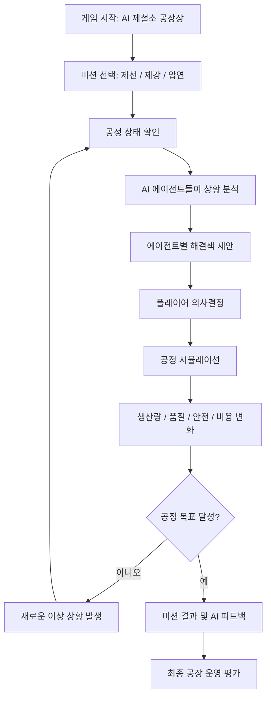
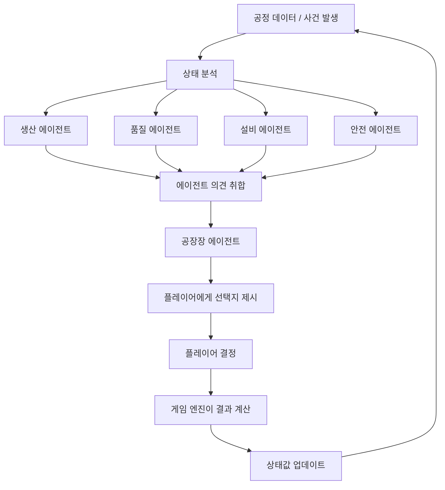

# STEEL MIND · AI 제철소 운영 시뮬레이션 (게임 기획안)

> 플레이어가 제철소 운영 책임자가 되어 AI 에이전트들의 서로 다른 판단을 조율하고, 생산·품질·설비·안전을 함께 관리하는 의사결정 시뮬레이션 게임.

팀 철든신입의 이전 프로젝트 「철든 신입」(신입사원 제철 공정 교육)을 바탕으로 한다. 실제 제철소 제어·운영을 대체하지 않는 가상의 교육·체험 시뮬레이션이다.

## 1. 목표

심사위원이 3분 안에 다음 세 가지를 이해하게 만든다. 게임을 복잡하게 만드는 것보다 이것이 우선이다.

1. 철강 생산 공정이 어떻게 진행되는지
2. AI 에이전트들이 왜 서로 다른 판단을 하는지
3. 플레이어의 결정이 생산·품질·안전에 어떤 영향을 주는지

- **핵심 경험**: 에이전트 제안 비교 → 플레이어 결정 → 운영 지표 변화 → 결과 분석
- **대상**: AI·제조업에 익숙하지 않은 참가자
- **전달할 메시지**: 에이전트의 역할 분담과 협업, 그 한계, 그리고 최종 판단은 사람이 해야 한다는 점

기존 AI 에이전트 체험이 프롬프트 작성이나 코딩에 집중한다면, STEEL MIND는 에이전트가 실제 업무 맥락에서 어떻게 협업하고 충돌하는지를 게임으로 경험하게 한다.

## 2. 게임 흐름



기본 구조: **공정 3개 × 난이도 3단계 × 에이전트 4개**

## 3. 에이전트 구성

| 에이전트 | 주요 목표 | 제안 예시 |
|---|---|---|
| 생산 | 생산량·납기 최적화 | 생산 속도 유지, 공정 지연 최소화 |
| 품질 | 제품 품질 기준 유지 | 조건 재조정, 검사 강화 |
| 설비 | 설비 안정성·가동률 관리 | 점검, 속도 제한, 정비 투입 |
| 안전 | 작업자 위험 최소화 | 위험 구역 통제, 작업 중지 |
| 공장장 | 의견 취합과 선택지 정리 | 에이전트 의견을 모아 플레이어에게 선택지 제시 |
| 운영 책임자(플레이어) | 전체 성과 균형 | 제안을 비교한 뒤 최종 결정 |

에이전트들은 같은 상황을 서로 다른 목표와 관점으로 분석한다. 이 의견 차이가 게임의 핵심 재미다.

에이전트는 대사만 출력하는 캐릭터가 아니다. **상태를 읽고 → 목표에 따라 판단하고 → 행동을 제안**해야 AI 게임이라고 할 수 있다.



### AI와 게임 엔진의 역할 분리

| 담당 | 하는 일 |
|---|---|
| LLM(에이전트) | 상황 요약, 원인 설명, 대응안 제안, 제안 간 차이 설명 |
| 게임 엔진 | 상태값 관리, 선택지 유효성 검증, 점수 계산, 이벤트 전개, 승패 판정 |

**원칙: LLM은 점수나 공장 상태를 직접 바꾸지 않는다.** 예를 들어 AI가 "안전 점수를 20점 낮추겠습니다"라고 정하는 것이 아니다. AI는 "작업 유지" 같은 행동을 제안하고, 점수는 게임 엔진이 미리 정한 규칙으로 계산한다. 그래야 결과를 재현할 수 있고, AI가 점수를 임의로 바꾸거나 규칙을 깨지 못한다.

## 4. 미션별 시나리오

공정마다 플레이어가 다른 종류의 판단을 하게 한다.

| 공정 | 발생 사건 | 핵심 갈등 |
|---|---|---|
| 제선 | 고로 온도 이상 | 생산량 vs 설비 안정성 |
| 제강 | 목표 성분 불일치 | 품질 vs 생산 시간 |
| 압연 | 설비 과열·작업자 접근 | 생산 연속성 vs 안전 |

### 시나리오 A. 제선: 고로 온도 이상

> 작성 필요. 원본 기획안에서 이 시나리오의 상세 내용이 빠져 있다. 핵심 갈등은 생산량 vs 설비 안정성이다.

### 시나리오 B. 제강: 목표 성분 불일치

목표 철강 제품의 성분이 기준에서 벗어났다.

- 생산 에이전트: 생산 일정을 지키자.
- 품질 에이전트: 성분을 조정해야 한다.
- 공장장 에이전트: 납기와 품질을 함께 고려해야 한다.

품질을 확보하기 위한 추가 조치가 생산 시간과 비용에 영향을 준다.

### 시나리오 C. 압연: 설비 과열과 작업자 위험 (MVP 미션)

압연 설비 온도가 오르고, 가동 중에 작업자가 위험 구역에 접근했다. 생산 일정은 촉박하다.

- 생산 에이전트: 속도를 유지해 납기 지연을 막자.
- 설비 에이전트: 속도를 낮추고 설비 상태를 점검하자.
- 안전 에이전트: 즉시 작업을 멈추고 위험 구역 접근을 막자.
- 품질 에이전트: 공정 조건 변화가 품질에 미칠 영향을 확인하자.

| 선택 | 행동 | 결과 경향 |
|---|---|---|
| 1. 생산 우선 | 속도 유지 | 생산 점수는 높지만 안전·설비 위험 증가 |
| 2. 균형 대응 | 속도 조정 및 점검 | 비용이 들지만 위험이 줄어듦 |
| 3. 안전 우선 | 일시 정지 및 구역 통제 | 안전 점수는 높지만 생산 지연 |

이 시나리오에서 안전은 단순한 점수 변수가 아니라 **필수 제약조건**이다. 실제 산업 안전에서 위험을 무시하고 생산량을 높이는 선택이 좋은 결과로 평가되면 안 되기 때문이다.

## 5. 난이도

난이도는 숫자를 키우는 대신, 플레이어가 고려할 변수와 에이전트 간 갈등을 늘리는 방식으로 올린다.

| 레벨 | 목표 | 구성 | 학습 목적 |
|---|---|---|---|
| LEVEL 1 · 신입 (Easy) | 안전하게 생산하기 | 에이전트 2개, 이상 상황 1개, 선택지 3개, 안전·생산량만 관리 | 에이전트의 역할과 게임 규칙 이해 |
| LEVEL 2 · 숙련 (Normal) | 생산과 품질 동시 확보 | 에이전트 4개, 이상 상황 2개 연속, 품질·비용 변수 추가, 에이전트 간 의견 충돌 | 여러 목표를 함께 고려한 의사결정 |
| LEVEL 3 · 공장장 (Hard) | 위기 속 공장 운영 | 에이전트 4개, 연속 설비 이상, 예산·시간 제한, 생산 중단과 안전 확보 사이 판단 | 복합적인 산업 운영 의사결정 |

MVP에서는 난이도 선택 기능을 만들지 않는다. LEVEL 1을 완성한 다음 LEVEL 2 사건 하나를 추가하는 데까지만 한다.

## 6. 점수와 등급

운영 성과는 네 지표로 나타낸다. 가중치는 게임 밸런스 테스트용 예시이고, 실제 산업 기준이 아니다.

| 지표 | 예시 수치 | 가중치 |
|---|---|---|
| 생산량 | 70 | 30% |
| 품질 | 80 | 25% |
| 안전 | 90 | 35% |
| 비용 효율 | 75 | 10% |
| **종합 운영 점수** | **80 / 100** | |

안전 지수가 하한선보다 낮아지면 생산량이 아무리 높아도 등급을 내린다. 그래야 생산량만 높이는 전략으로 쉽게 이기지 못한다.

| 등급 | 조건 |
|---|---|
| S | 안전 확보 + 종합 90 이상 |
| A | 안전 확보 + 종합 80 이상 |
| B | 안전 확보 + 종합 65 이상 |
| 실패 | 안전 임계치 미달 또는 공정 중대 실패 |

## 7. 화면 구성

| 화면 | 내용 |
|---|---|
| ① 공장 대시보드 | 현재 공정, 생산 목표 달성률, 안전 지수, 품질 지수, 운영 자금, 현재 이벤트 |
| ② 에이전트 회의실 | 에이전트별 판단, 근거, 예상 영향 |
| ③ 의사결정 | 에이전트 제안 중 하나를 고르거나 직접 명령. 선택지별 트레이드오프 비교 |
| ④ 결과 보고서 | 결정에 따른 생산량·품질·안전·비용 변화, 에이전트 협업 분석 |

대시보드 예시:

```
STEEL MIND                       공정 정상 가동
DAY 01 · 압연 공정 운영
생산 목표 72%   안전 지수 92   품질 지수 85   운영 자금 ₩80M
```

## 8. 데이터 구조 (구현용)

```json
{
  "game": {
    "name": "STEEL MIND",
    "stage": "rolling",
    "difficulty": "normal"
  },
  "factory_state": {
    "production": 70,
    "quality": 80,
    "safety": 90,
    "cost_efficiency": 75
  },
  "agents": [
    { "id": "production", "goal": "maximize_production", "priority": 30 },
    { "id": "quality", "goal": "maintain_quality", "priority": 25 },
    { "id": "equipment", "goal": "prevent_equipment_failure", "priority": 20 },
    { "id": "safety", "goal": "prevent_safety_incidents", "priority": 35 }
  ],
  "event": {
    "id": "rolling_temperature",
    "description": "압연 설비 온도 상승",
    "choices": ["continue_production", "reduce_speed", "stop_and_inspect"]
  }
}
```

## 9. 해커톤 MVP 범위

하나의 공정, 하나의 미션을 끝까지 완성하는 것을 우선한다.

**필수**

- 압연 과열 이벤트 1개
- 서로 다른 제안을 내는 에이전트 3~4개
- 플레이어 선택지 3개
- 규칙 기반 지표 변화
- 미션 결과 리포트
- AI가 제안 이유를 짧게 설명하는 기능

**후순위**

- 여러 공정과 연속 미션
- 난이도 선택
- 에이전트 성격·목표 커스터마이징
- 리더보드와 멀티플레이

**구현 원칙: 기획은 공정 3개로 잡고, MVP는 압연 공정 하나로 만든다.** 오늘 모든 공정을 완성하려 하지 않는다. 압연 공정에서 사건 발생 → 에이전트 제안 → 선택 → 점수 변화 → 결과 화면이 끝까지 돌아가면, 제선·제강은 시나리오를 추가하는 방식으로 넓힌다. 오늘 안에 시연할 수 있는 결과물을 만들 확률이 가장 높은 설계다.

### 역할 분담안

| 역할 | 맡는 일 |
|---|---|
| 총괄 | 게임 시스템 설계, 에이전트 구조, 전체 통합 |
| 팀원 1 | 기존 게임 UI와 제철소 배경 변경 |
| 팀원 2 | 미션 시나리오와 점수 계산 로직 |
| 팀원 3 | AI 에이전트 응답과 결과 화면 |

인원이 다르면 역할을 합친다. 실제 담당자 이름은 팀에서 정한다.

## 10. 제출 기획서 구성 (11/9 13:30 제출)

너무 길게 만들지 않는다. 6쪽으로 구성한다.

| 쪽 | 내용 |
|---|---|
| 1 | 프로젝트명·문제 정의 |
| 2 | 게임 컨셉·타깃 사용자 |
| 3 | 철강 생산 공정과 게임 진행 |
| 4 | 에이전트 구성과 의사결정 구조 |
| 5 | 난이도·시나리오·점수 시스템 |
| 6 | 구현 범위·기대 효과 |

## 11. 성공 기준

- 처음 접한 참가자가 짧은 안내만으로 미션 하나를 끝낼 수 있다.
- 에이전트별 목표와 의견 차이가 화면에서 분명히 보인다.
- 선택에 따른 결과가 일관된 규칙으로 계산된다.
- 참가자가 "AI 제안은 참고하고 최종 판단은 사람이 한다"는 경험을 얻는다.

## 12. 팀 확인 필요

- 시나리오 A(제선) 상세 내용이 비어 있다.
- 데이터 구조의 에이전트 `priority`(30·25·20·35, 합 110)와 점수 가중치(생산 30·품질 25·안전 35·비용 10)는 서로 다른 값이다. `priority`가 무엇에 쓰이는지 정해야 한다.
- 안전 하한선의 구체적인 값
- 의사결정 화면의 "직접 명령"을 MVP에 넣을지 여부
- 역할 분담안의 실제 담당자
- 이 레포의 원래 주제(측정 신뢰성 판별기, `README.md`)와의 관계: 주제를 바꾸는지, 따로 진행하는지

## 발표용 요약

STEEL MIND는 AI 에이전트들이 각자의 목표를 갖고 협업하는 가상 제철소를 운영하는 시뮬레이션 게임이다. 플레이어는 생산·품질·설비·안전 에이전트의 제안을 비교하고 최종 결정을 내린다. AI는 분석과 제안을 맡고, 게임 상태와 점수는 규칙 기반 엔진이 관리한다. 이를 통해 에이전트 협업과 사람의 의사결정을 쉽고 재미있게 체험하게 한다.
